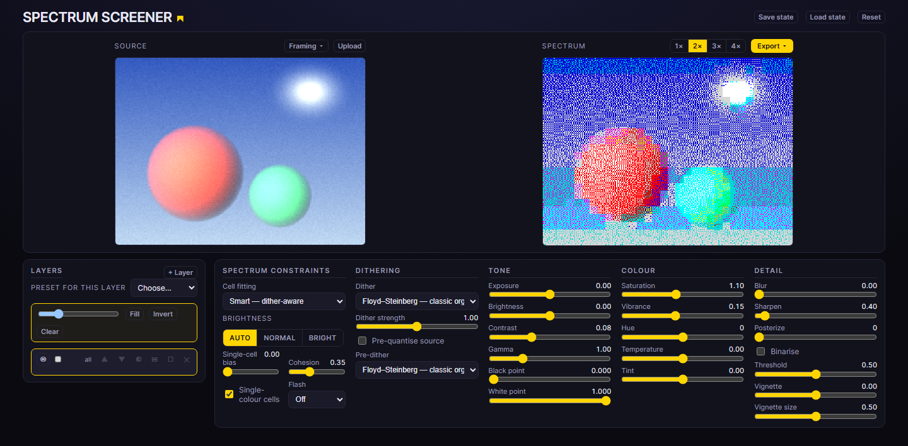

# Spectrum Screener

Convert a PNG, JPEG or WebP into an authentic ZX Spectrum screen — 256×192, 15 colours,
**two per 8×8 cell** — with live control over tone, colour, dithering and attribute clash.

Runs entirely in the browser. No upload, no server, no dependencies at runtime.



## Why this is not just colour quantisation

A Spectrum screen is 6912 bytes:

| Region | Size | Meaning |
| --- | --- | --- |
| bitmap | 6144 B | 1 bit per pixel, 32 bytes per scanline |
| attributes | 768 B | one byte per 8×8 cell: FLASH, BRIGHT, PAPER, INK |

Each attribute picks **two** colours for its whole 8×8 cell: ink (bit set) and paper (bit
clear). Both must come from the same half of the palette — all normal or all bright — except
black, which is legal with either. A third colour in a cell is impossible. That single
restriction is *attribute clash*, and it is the whole design problem: the tool's job is to
spend its two colours wisely, per cell.

The palette, at the usual `#D7` normal / `#FF` bright levels:

```
normal  #000000 #0000d7 #d70000 #d700d7 #00d700 #00d7d7 #d7d700 #d7d7d7
bright  –––––––– #0000ff #ff0000 #ff00ff #00ff00 #00ffff #ffff00 #ffffff
```

## Getting started

```bash
npm install
npm run dev      # http://localhost:6912
```

Drop an image on the page, paste from the clipboard, or hit **Upload**. Then drag sliders.

```bash
npm run check    # all test suites: pipeline, UI, vignette, layers
npm run build    # typecheck + production bundle
npm run layout   # measure the real page in headless Chromium
```

## How it works

1. **Fit** — area-average the source into 256×192 (`fit`, `fill` or `stretch`). Averaging
   rather than nearest-neighbour matters: high-frequency detail becomes honest mid-tones
   instead of aliased noise that dithering then has to fight.
2. **Adjust** — exposure in linear light, black/white point, then gamma-space contrast and
   gamma, then vibrance, saturation, hue, temperature and tint. Optionally blur, unsharp
   mask, posterise or binarise. Every colour decision is made in OKLab.
3. **Fit cells** — for each 8×8 cell, choose the best legal colour pair.
4. **Cohesion** — let a cell reuse a neighbour's pair when it is nearly as good, which cuts
   the number of distinct attributes and calms cell borders.
5. **Dither** — decide, per pixel, which of its cell's two colours it gets.
6. **Pack** — bitmap plus attributes to `.scr`, `.tap`, C, assembler or PNG.

### Choosing each cell's two colours

| Method | Idea | Looks like |
| --- | --- | --- |
| **Smart** (default) | squared distance from each pixel to the **segment** between the two colours, i.e. assuming dithering can mix them freely | detailed, photographic |
| **Exhaustive** | nearest of the two colours only, no mixing assumed | crisp, contrasty, noisy |
| **Frequency** | the cell's two most common nearest palette colours | good on flat art |
| **Average** | fit the cell's mean colour exactly | smooth gradients, destroys text |

Two details are what make Smart behave, and both came from looking at bad output:

- Scoring uses the **real pixel values**, not only a histogram binned to the palette. A flat
  cell whose colour is not in the palette bins to a single entry, and then every pair
  containing that entry ties at zero distance — the first candidate (usually black) wins by
  accident, and flat skies fill with black speckle.
- Pairs pay a small penalty proportional to segment length. A flat cell ties between "blue"
  and "black + blue" (both reach it exactly), so without the penalty it dithers instead of
  choosing the solid colour. A genuine gradient more than repays the penalty.

### Dithering

Dithering runs **inside each cell's own colour axis**. A cell can only express a pixel's
position `t` along the line between its two colours, so each pixel is projected onto that
segment and a single scalar error is diffused. Diffusing full RGB error instead leaks each
cell's chromatic error into its neighbours, producing coloured speckle in areas that should be
flat — and it cannot help, because a pair cannot reproduce the component perpendicular to its
own segment.

| Kernel | Character |
| --- | --- |
| Floyd–Steinberg | classic, organic |
| Atkinson | passes on only ¾ of the error: airy, keeps highlights |
| Jarvis–Judice–Ninke | wide and soft |
| Stucki | cleaner, converges faster than Floyd |
| Sierra | between Floyd and Jarvis |

Ordered alternatives are **Bayer 8×8** (one matrix cell per Spectrum cell, so the pattern
aligns with the attribute grid), Bayer 4×4, Bayer 2×2, and hash noise. All diffusion kernels
use serpentine scanning.

**Strength** scales the diffused error; 0 collapses to a hard threshold at mid-grey.

An optional **pre-quantise** pass snaps the whole source onto the palette before cells are
fitted — the old-school pipeline. It tames noisy scans but destroys tone, so it is off by
default.

## Layers

One picture, several treatments. Each layer carries its own tone, colour, detail and
dithering, and owns a painted region of the source.

- **Add layer**, then paint on the source to claim pixels (Alt/Option erases).
- **Topmost wins** where masks overlap; unpainted pixels fall through to the base.
- An attribute covers a whole cell, so a **cell follows whichever layer owns most of it** —
  that layer's palette constraints, fitting method and dither apply. Each *pixel's* colour
  pipeline still comes from the layer that owns that pixel, which is what lets a crisp logo
  sit next to a Floyd-dithered photo.
- Diffusion deliberately crosses region borders, so a dithered region does not end in a hard
  seam against its neighbour.

### Compositing attributes and pixels

Because the attribute area and the bitmap are separate memory regions on real hardware, the
two-colour pair and the dither pattern can come from different layers:

| Mode | Meaning |
| --- | --- |
| `own` | this layer fits its pair and dithers it |
| `attrs from …` | take another layer's colour pair, keep this layer's dither pattern |
| `pixels from …` | keep this layer's pair, take another layer's bit pattern |

`attrs from` is the interesting one: borrow one layer's palette decisions while keeping a
different dither for texture. When a layer borrows attributes, the donor fits its pair against
the pixels being coloured rather than only the pixels it owns, so the pair actually describes
the region it is applied to.

## Exports

| Format | Use |
| --- | --- |
| `.scr` | raw 6912-byte screen memory (bitmap then attributes); `LOAD "" SCREEN$`-able |
| `.tap` | cassette image with a code block at `0x4000`; loads on hardware and in Fuse/ZEsarUX |
| `.h` / `.asm` | byte arrays in Spectrum screen order |
| `.json` | attributes plus statistics, for automated comparison |
| `.png` | the result at ×3 |

**Save state** writes a self-contained `.screener.json` — every layer's options and painted
mask, framing, and the source image — so a setup can move between machines or be kept as a
variant.

## Notable details

- **Ink is the minority colour** in every cell, so the bitmap has fewer set bits, which is what
  every ZX screen compressor wants.
- **BRIGHT** comes from whichever colour of the pair has a bright variant, so black plus a
  bright colour is legal and renders bright.
- **Single-colour cells**, when disallowed, keep a genuine two-colour pair; cells where
  dithering converges simply get an all-ink or all-paper bitmap rather than having pixels
  invented to force a pattern.
- The Spectrum view renders at **whole-integer scale only** (1×–4×). A fractional factor
  resamples the 1-bit pixels into grey mush and makes dithering impossible to judge.
- Everything persists across reloads: layers, masks, framing, scale, and the image itself.

## Project layout

```
src/core/     palette, colour science, adjustments, cell fitting, dither, packing
src/ui/       schema-driven controls, state, prefs, loader, export plumbing
src/workers/  conversion off the main thread
bench/        test suites and visual harnesses (see bench/README.md)
docs/         screenshots for this README
```

The control panel is generated from a schema, so adding a slider is a one-line change in
`src/ui/schema.ts`.

`npm run check` asserts the invariants that actually matter: `.scr` is 6912 bytes, every
attribute's ink and paper sit in the same palette half, no cell uses a third colour, and
`toScr`→`fromScr` round-trips losslessly. It also covers layer ownership and blending, state
file round-tripping, vignette geometry, and the page's real DOM wiring.

## Dev server

The port is pinned to **6912** in `vite.config.ts` with `strictPort`. 6912 is the size of a
Spectrum `.scr` in bytes, and pinning avoids fighting other local projects over Vite's default
5173 — a clash fails loudly instead of drifting to another port.

## Hosting

The app is fully static — no server, no runtime dependencies — so any static host works. It is
built with **relative** asset URLs (`base: './'`), so the same `dist/` runs at a domain root, at
a project subpath, or from a `file://` dump without rebuilding.

### GitHub Pages (configured)

`.github/workflows/pages.yml` deploys on every push to `main`: it installs, runs `npm run check`,
builds, and publishes `dist/`. The suites gate the deploy, so a build that breaks an invariant
never reaches the live site.

One-time setup, once per repo:

1. **Settings → Pages → Build and deployment → Source: GitHub Actions**
2. Push to `main` (or run the workflow from the Actions tab).

It then lives at `https://<owner>.github.io/screener/`.

### Cloudflare R2 / any bucket

`dist/` is self-contained (~80 kB), so it can be uploaded as-is:

```bash
npm run build
wrangler r2 object put my-bucket/screener/index.html --file dist/index.html
# ...and the rest of dist/, preserving the assets/ prefix
```

Because paths are relative, it works from a prefix like `/screener/` on a custom domain without
any config change. R2 needs a Worker or custom domain in front to serve it as a website, which
is the main trade-off against Pages.

### Why the sample pictures are not deployed

`public/samples/` holds generated images used only by the dev harnesses in `bench/`; nothing in
the app references them. `copyPublicDir: false` keeps 370 kB of them out of the deployed bundle,
leaving a total of ~80 kB.

## References

- [Screen memory layout](http://breakintoprogram.co.uk/hardware/computers/zx-spectrum/screen-memory-layout)
- [Attribute clash](https://en.wikipedia.org/wiki/Attribute_clash) · [ZX Spectrum graphic modes](https://en.wikipedia.org/wiki/ZX_Spectrum_graphic_modes)
- [Ordered dithering](https://en.wikipedia.org/wiki/Ordered_dithering) · [Error diffusion](https://en.wikipedia.org/wiki/Error_diffusion)
- [img2spec](https://github.com/jarikomppa/img2spec) / [Spectrumizer](https://solhsa.com/spectrumizer) — interactive modifier stacks
- [puregrain](https://github.com/roman-mkh/puregrain/blob/master/docs/machine-screens/README.md) — segment-distance cell scoring
- [ZX Spectrum raytracer](https://gabrielgambetta.com/zx-raytracer.html) — most-frequent-two-colours and per-cell Bayer

## Licence

[MIT](LICENSE) © Damien Guard
